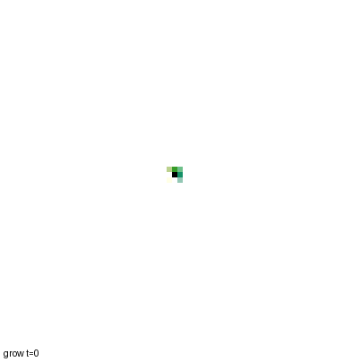
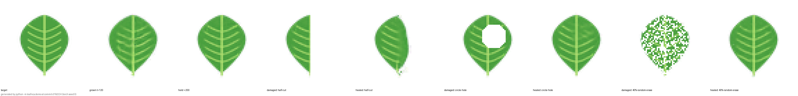

# Leaf NCA

**Every cell runs the same tiny rule, with no blueprint, and the leaf heals when you cut it.**



A neural cellular automaton (NCA) on a 64×64 grid. Each cell holds 16 numbers: colour (RGB), "aliveness"
(alpha) and 12 hidden channels. At every step, each cell looks only at its 3×3 neighbourhood (Sobel
gradients), passes that through the same small network (≈8k parameters), and adds the result to its own
state. Half of the cells update at random each step, so there is no global clock. Training starts from one
live cell and teaches the rule to grow a veined leaf and keep it. During training some leaves are damaged
so the rule also learns to repair.



| | MSE vs target |
|---|---|
| untrained rule, 120 steps from one cell | 0.100 |
| trained rule, grown (120 steps) | 0.00034 |
| after 200 more steps (stability) | 0.00009 |
| circular hole → healed (150 steps) | 0.027 → 0.0003 |
| 40% random erase → healed | 0.040 → 0.0003 |
| half the leaf cut off → after 150 steps | 0.051 → 0.031 (does **not** regrow) |

Numbers come from `results/demo_metrics.json` (one demo run, MPS, torch seed 0). [REPORT.md](REPORT.md) has
four small experiments: stability, recovery by damage type over 20 positions, how much healing is luck, and
whether the pattern lives in the hidden state.

## Run it

```bash
python3.13 -m venv .venv && source .venv/bin/activate
pip install -r requirements.txt && pip install -e .
pytest                                                   # 14 fast tests, ~10 s
python -m leafnca.train --steps 8000 --max_minutes 30 --out runs/run2   # ~17 min on an M4 (MPS)
cp runs/run2/model.pt results/model.pt
python -m leafnca.demo                                   # results/demo.gif, demo_strip.png
for s in 01_grow_hold 02_damage_heal 03_fate_curve 04_hidden_vs_visible; do python experiments/$s.py; done
python experiments/make_tables.py                        # results/tables.md
```

The trained checkpoint is committed (`results/model.pt`, 36 KB), so you can skip training.

## Layout

`src/leafnca/` model, leaf target, damage, metrics, train and demo CLIs · `experiments/` one script per
experiment, each writing to `results/<name>/` · `tests/` pytest · `original/` the starting `nca.py`/`leaf.py`.
Code builds on the Growing NCA design (Mordvintsev et al., 2020, google-research/self-organising-systems).

## Honest limits

- One pattern, one architecture, one 64×64 grid, one main trained model (plus a 3-seed pilot).
- The target is a simple drawn leaf (midrib + 5 vein pairs), not a grown venation network. The rule learns
  to **reproduce** a picture. It does not model how real veins form.
- It repairs damage like it saw in training (circles, scattered holes). It does not regrow a leaf cut in half.
- MSE is a pixel metric. "Healed" means within 1.5× of the grown leaf's MSE, a threshold we chose.

See [DECISIONS.md](DECISIONS.md) for every judgement call and [STATUS.md](STATUS.md) for what works.
