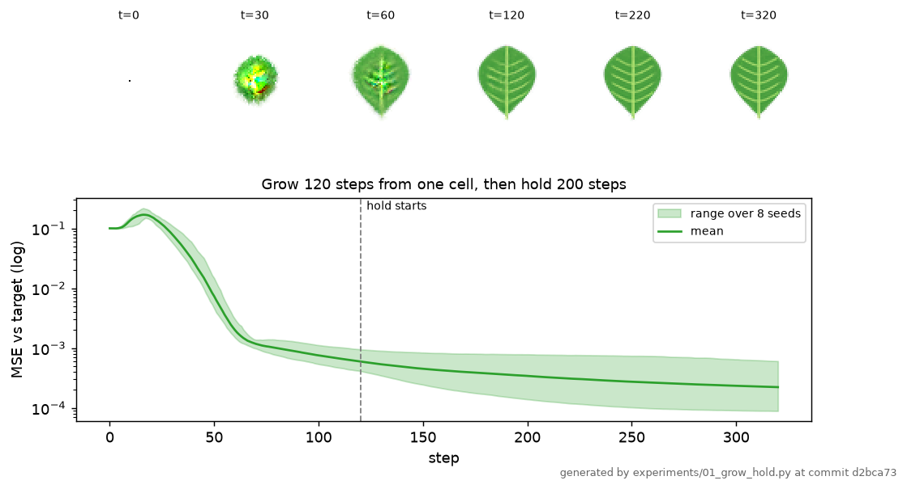
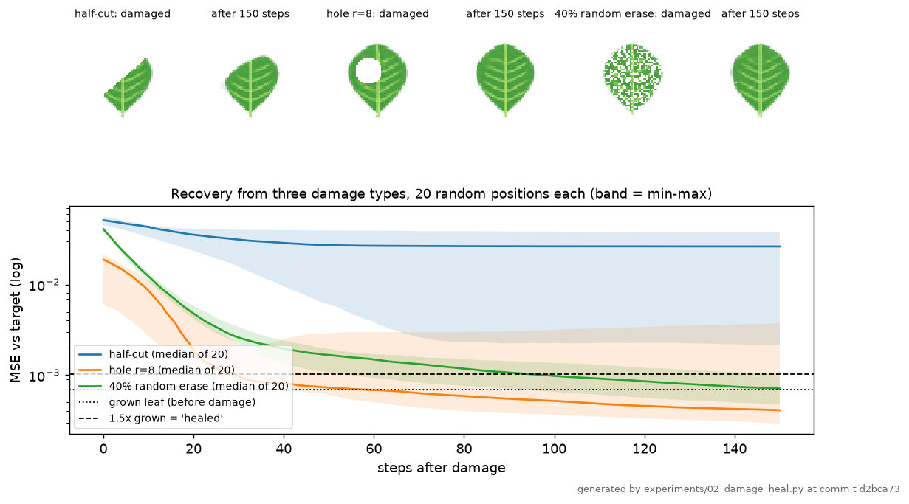
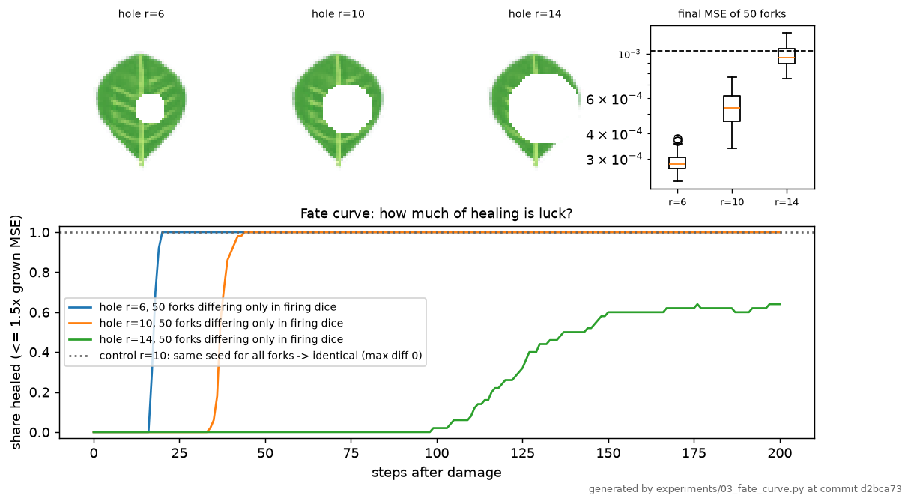
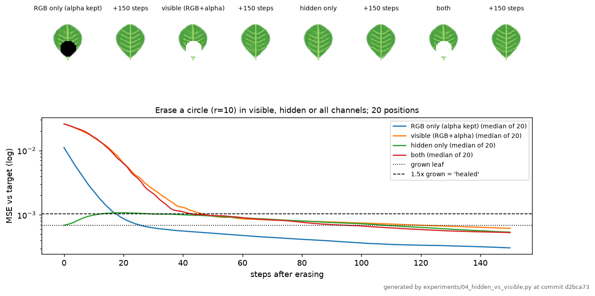
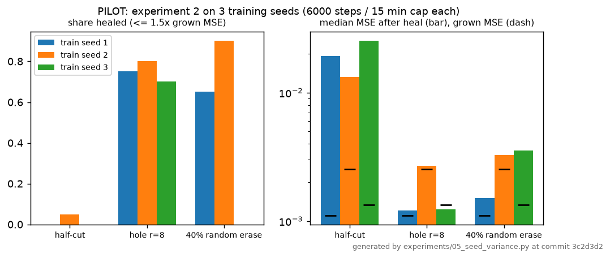

# Leaf NCA: findings

What was tested: one trained neural cellular automaton (16 channels, hidden layer 128, 8000 training steps,
run 2 in [DECISIONS.md](DECISIONS.md)) that grows a procedural veined leaf on a 64×64 grid from one cell.
All numbers below come from `results/*/summary.csv|json`. They were produced by `experiments/0x_*.py` at
commit `d2bca73` (CPU, firing seed 0, checkpoint `results/model.pt`, training step 8000) and turned into
tables by `experiments/make_tables.py` (full tables: [results/tables.md](results/tables.md)).

**Metric.** MSE between the visible channels (premultiplied RGB + alpha) and the target picture. "Healed" means
MSE ≤ 1.5× the MSE of the undamaged grown leaf. Reference grown leaf (120 steps, seed 0, CPU): MSE 0.00069.
For scale: an untrained rule left at a single cell scores 0.100.

**Limits that apply to everything here.** One target pattern, one architecture, one small grid, one main
trained model (training seed 0; a 3-seed pilot in experiment 5). The leaf is a drawn picture, and the
rule learns to reproduce it. Nothing here models how real veins develop.

---

## 1. Grow and hold

**Question.** Once the leaf is grown, does it stay stable?

**Setup.** 8 runs that differ only in the random firing mask. Grow 120 steps from one cell, then run 200 more.

| runs | MSE at step 120 (mean) | MSE at step 320 (mean) | end / grown ratio (mean, max) | runs staying within 1.5× during hold |
|---|---|---|---|---|
| 8 | 0.00060 | 0.00022 | 0.338, 0.636 | 8 of 8 |

**Result.** Yes. In all 8 runs the leaf keeps improving slightly during the hold (MSE about 3× lower after 200
extra steps) and never drifts above where it started.

**What this does not show.** Stability for longer than 320 steps, or on a larger grid. Training rollouts were
64–96 steps, so the 200-step hold is already outside what training saw, but thousands of steps were not tested.

## 2. Damage and heal

**Question.** How much does the leaf recover, by damage type?

**Setup.** One grown leaf. Three damage types, 20 random placements each, then 150 healing steps.
*Half-cut:* everything on one side of a line through the centre, at a random angle. *Hole:* radius 8 at a
random spot on the blade. *Random erase:* 40% of cells.

| damage | n | MSE after damage (mean) | MSE after heal (median) | MSE after heal (max) | recovered fraction (median) | share healed |
|---|---|---|---|---|---|---|
| half-cut | 20 | 0.0515 | 0.0263 | 0.0378 | 0.51 | 0.00 |
| hole r=8 | 20 | 0.0161 | 0.00041 | 0.0037 | 1.01 | 0.80 |
| 40% random erase | 20 | 0.0405 | 0.00071 | 0.0010 | 1.00 | 0.95 |

**Result.** Holes and scattered erasure heal back to the grown leaf (median recovery about 100%; 80% and 95%
of placements fall within the healed threshold). Half-cuts never heal: the rule recovers about half the lost
error, then stalls with a lopsided leaf.

**What this does not show.** That the rule "understands" the whole leaf. Training only ever used circular
damage of radius up to about 13 cells, and the half-cut is far outside that. Whether training with half-cuts
would fix it was not tested.

## 3. Luck versus skill (fate curve)

**Question.** How much of the outcome is dice?

**Setup.** One grown leaf, one hole just right of the midrib, then 50 copies that differ **only** in the random
firing mask. Share healed against steps, for radius 6, 10 and 14. Control: 50 copies that all use the same
random seed.

| hole radius | MSE after damage | healed at step 50 | at 100 | at 200 | first copy healed (step) | half healed (step) |
|---|---|---|---|---|---|---|
| 6 | 0.0124 | 1.00 | 1.00 | 1.00 | 17 | 18 |
| 10 | 0.0328 | 1.00 | 1.00 | 1.00 | 34 | 37 |
| 14 | 0.0617 | 0.00 | 0.02 | 0.64 | 99 | 137 |

Control (radius 10, same seed for all 50 copies): largest state difference between copies = **0.0**,
so all copies are identical.

**Result.** For small and medium holes the dice hardly matter: all 50 copies heal within a few steps of each
other. For the large hole the dice matter a lot. The first copy heals at step 99, half have healed by step
137, and by step 200 only 64% have. The same damage gives a different outcome depending only on the order
in which cells fired. The control shows that this spread comes from the firing mask alone.

**What this does not show.** Whether the slow copies would all heal eventually (only 200 steps were run), or
how the spread depends on hole position. Only one position was tested.

## 4. Where is the memory? (hidden versus visible)

**Question.** Is the pattern stored in the hidden state, or rebuilt from neighbours?

**Setup.** A circle of radius 10 at 20 random places on the grown leaf. Zero (a) only RGB and keep alpha,
(b) the visible channels RGB+alpha, (c) only the 12 hidden channels, (d) everything. Then 150 steps.
Condition (a) was added because erasing alpha marks a cell as dead. The alive rule then wipes its hidden
state on the next step (80% of cells in the region for (b)), so (b) alone barely differs from (d).

| erased | MSE right after | peak MSE while recovering (mean) | MSE after 150 steps (median) | share healed | median steps to heal | region cells dead after 1 step |
|---|---|---|---|---|---|---|
| RGB only (alpha kept) | 0.0109 | 0.0109 | 0.00031 | 1.00 | 18 | 0% |
| visible (RGB+alpha) | 0.0254 | 0.0254 | 0.00062 | 0.85 | 44 | 80% |
| hidden only | 0.00069 | 0.0031 | 0.00054 | 0.60 | (looks fine at step 0) | 0% |
| both | 0.0254 | 0.0254 | 0.00053 | 0.80 | 42 | 90% |

**Result.** Both. If cells keep their hidden state and aliveness, they repaint their colour fastest (median 18
steps). If the hidden state is erased but the picture is left intact, the picture *gets worse*: mean error
rises about 4.5× before recovering, and 40% of placements are still outside the healed threshold at step
150. Cells without hidden state lose their colour until their neighbours re-instruct them. When everything
is erased, the region regrows from its neighbours in about 42 steps. So the colour is not self-sustaining.
It is held up by the hidden state, which neighbours can rebuild.

**What this does not show.** *What* the hidden channels encode. No channel-by-channel analysis was done. These
results are also tied to this architecture's alive rule, which couples alpha to survival.

## 5. Training-seed variance (pilot)

**Question.** How much do the damage-and-heal results (experiment 2) depend on the training seed?

**Setup (pilot).** 3 new models, training seeds 1–3, each trained for 6000 steps (~12.5 min, cap 15 min) instead of 8000. Experiment 2 was rerun unchanged on each (`results/05_seed_variance/`, commit `3c2d3d2`).

| train seed | grown MSE | half-cut: share healed | hole r=8: share healed (median recovered) | 40% erase: share healed (median recovered) |
|---|---|---|---|---|
| 1 | 0.0011 | 0.00 | 0.75 (0.99) | 0.65 (0.99) |
| 2 | 0.0025 | 0.05 | 0.80 (0.99) | 0.90 (0.98) |
| 3 | 0.0013 | 0.00 | 0.70 (1.00) | 0.00 (0.94) |

**Result.** The qualitative picture holds for all three seeds: holes and scattered erasure recover about 94–100% of the damage, and half-cuts do not regrow (at most 1 of 20). The exact "share healed" depends heavily on the seed (0% to 90% for random erase). It also depends on the threshold: seed 3 recovers 94% of the erase damage but stays just above 1.5× its own grown MSE. Grown-leaf quality varies about 2.3× between seeds, and all three are worse than the 8000-step main model (0.00069).

**What this does not show.** A reliable spread. Three seeds at a shorter budget is a pilot, and these models are not the main model.

---

## Overall limits

- **One pattern** (a drawn leaf with a midrib and 5 vein pairs), **one architecture** (Growing-NCA style,
  16 channels), **one grid** (64×64), **one main training seed**, and a short 8000-step training run.
- 20 damage placements and 50 forks per condition are enough to show the effects above. They are not enough
  for precise rates. Treat shares as ±~10 percentage points.
- The healed threshold (1.5× grown MSE) is our choice. A pixel MSE can call a slightly blurred leaf healed.
- The demo numbers in the README come from a separate run on the Mac GPU (MPS) with its own random stream,
  so they differ slightly from the CPU experiment numbers here (e.g. grown MSE 0.00034 vs 0.00069).
